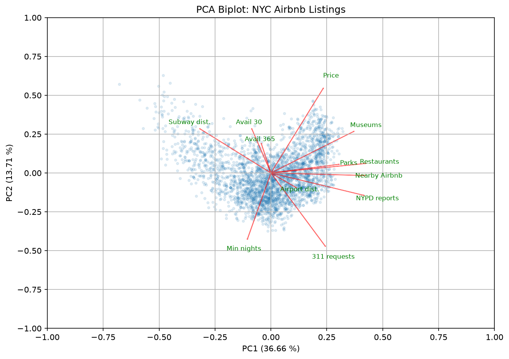

# Project 2: Data Integration, Research Question Refinement, and PCA

**Notebook:** [CDS303_Final_Project2_Final_Demo06.ipynb](Projects/Project2/CDS303_Final_Project2_Final_Demo06.ipynb)

**Team member: Seohyun Hong, Sieun Woo, Seoyoung Yun**

---

## 1. Data Integration and Preparation

### 1.1 Datasets
| Dataset | Provider | Original unit (one row =) | Time | PCA input variable |
|---|---|---|---|---|
| **Primary:** NYC detailed listings | Inside Airbnb | one listing | Sep 14, 2026 snapshot | price, availability (30 / 365 days), minimum nights, guest capacity, reviews in last 12 months, estimated booked nights, nearby Airbnb listings |
| NYC calendar | Inside Airbnb | one listing on one date | Sep 14, 2026 – Sep 14, 2027 | weekend gap |
| NYPD Complaint Data (Year To Date) | NYC Open Data | one reported incident | Jan–Aug 2026 | reported incidents within 1 km |
| 311 Service Requests – Noise - Residential only | NYC Open Data | one complaint | Jan–Aug 2026 | noise complaints within 1 km |
| DOHMH Restaurant Inspection Results | NYC Open Data | one inspection | Inspections on or before Sep 14, 2026 | restaurants within 500 m |
| CommonPlace (parks, museums) | NYC Open Data | one place | Nov 2026 download | parks / museums within 1 km |
| MTA Subway Stations and Complexes | NY State Open Data | one station | Nov 2026 download | distance to nearest subway |
| MTA bus stops | NY State Open Data | one bus stop | Nov 2026 download | bus stops within 500 m |
| Airports (JFK, LGA, EWR) | OurAirports | one airport | — | distance to nearest airport |
| PLUTO | NYC Department of City Planning | one tax lot | Nov 2026 download | median floors and median year built within 200 m |
| ACS 5-year, table B25064 (with TIGER/Line 2024 tracts) | U.S. Census Bureau | one census tract | 2020–2024 | median gross rent of the listing's tract |

### 1.2 What each row represents and how the datasets connect
- **One row in the combined dataset = one Airbnb listing.**
- **Calendar → listing ID.** The calendar has about 365 rows per listing. We first **aggregated** it to one row per listing (weekday and weekend availability rates) and then merged on `id` = `listing_id`. The bus-stop counts were also merged by `id`.
- **Point datasets → distance.** NYPD, 311, restaurants, parks, museums, subway, airports, and PLUTO tax lots have no Airbnb ID, so we used each listing's latitude and longitude and **transformed** each source into per-listing values (counts within a radius, distance to the nearest point, or the median of nearby tax lots).
- **ACS → census tract (spatial join).** Following the professor's spatial-join example, we placed each listing in its 2024 census tract with `gpd.sjoin(..., predicate='within')` and attached that tract's median gross rent by `GEOID`.

### 1.3 Merge checks
| Check | Result |
|---|---|
| Rows before / after integration | 29,918 / 29,918 |
| Duplicate listing IDs | 0 |
| Listings without calendar data or bus-stop count | 0 |
| Listings without a census tract | 0 |
| Listings in tracts without an ACS rent estimate | 266 (filled with the median) |
| Duplicates removed before counting | Restaurants by `CAMIS`, NYPD by `CMPLNT_NUM`, 311 by `Unique Key`, subway by `Complex ID`, PLUTO by `bbl` |

### 1.4 Matching time periods
The Airbnb listings are a **September 14, 2026** snapshot.
- Restaurant records were limited to inspections **on or before September 14, 2026** (30,161 restaurants).
- NYPD incidents (372,940) and 311 complaints (249,908) were limited to **January–August 2026**.
- CommonPlace, MTA subway, bus-stop, and PLUTO files were downloaded in November 2026. Parks, museums, transit stops, and buildings change slowly, so we used them, but we note that they may not show exact September conditions.
- ACS rents are **2020–2024 five-year averages**, not September 2026 rents.

### 1.5 Missing values
- `price` is missing for **10,512 listings (35.1%)**. Almost all listings with 0 available days in the next year (7,009 of 7,018) have no price. We **removed** listings without a positive price, so the PCA uses **19,406 listings** that are actively offered.
- Among these listings, missing values were filled with the median: minimum nights (7), building variables (14), and tract rent (189).

### 1.6 Variable selection
**PCA input variables (20):**

| Group | Variable | Meaning | Transformation |
|---|---|---|---|
| Host settings | `log_price` | Nightly price | Capped at 99th percentile ($2,000), log1p |
| | `availability_30` | Open days in the next 30 days | — |
| | `availability_365` | Open days in the next 365 days | — |
| | `log_minimum_nights` | Minimum stay | Capped at 99th percentile, log1p |
| | `log_accommodates` | Guest capacity | log1p |
| Booking activity | `log_number_of_reviews_ltm` | Reviews in the last 12 months | log1p |
| | `estimated_occupancy_l365d` | Estimated booked nights in the last 365 days | — |
| | `weekend_gap` | Weekday − weekend availability rate (calendar) | — |
| Location | `log_nearby_airbnb_listings_500m` | Other Airbnb listings within 500 m | log1p |
| | `log_reported_incidents_1km` | NYPD reported incidents within 1 km | log1p |
| | `log_restaurants_500m` | Restaurants within 500 m | log1p |
| | `log_parks_1km` | Parks within 1 km | log1p |
| | `log_museums_1km` | Museums within 1 km | log1p |
| | `log_service_requests_1km` | 311 residential noise complaints within 1 km | log1p |
| | `log_subway_distance_km` | Distance to nearest subway complex | log1p |
| | `bus_stops_500m` | Bus stops within 500 m | — |
| | `airport_distance_km` | Distance to nearest airport | — |
| Buildings & rent | `log_building_floors_200m` | Median floors of tax lots within 200 m | log1p |
| | `building_year_200m` | Median year built of tax lots within 200 m | — |
| | `log_median_rent` | Median gross rent of the census tract | log1p |

- **Booking activity.** Reviews and estimated booked nights show whether a listing is actually being booked, which open calendar days cannot show.
- **Calendar variable.** The weekday and weekend availability rates are almost identical to `availability_365` (correlations 0.996–0.998), so we used their difference instead. A positive weekend gap means weekends fill up before weekdays.
- **Building variables.** Airbnb coordinates are shifted by up to about 150 m, so we used the median of all tax lots within 200 m instead of a single building.
- **Not used in PCA:** IDs, coordinates, and tract IDs (not measurements); room type, borough, host listing count, and license status (categorical, kept to explain the results; see 3.4); share of one- and two-family lots (−0.79 with restaurants), reviews in the last 30 days (0.78 with 12-month reviews), bedrooms (0.49 with guest capacity), estimated revenue (price × booked nights), and review scores (26% missing).

### 1.7 Standardization
The 20 variables are measured in different units (days, dollars, counts, kilometers, floors, years). Without scaling, variables with large ranges such as `building_year_200m` and `availability_365` would dominate. Following Demo 6, we used `StandardScaler` so every variable has mean 0 and standard deviation 1.

---

## 2. Refined Research Question and Audience

**Research question.**
> How do NYC Airbnb listings differ in their surroundings (nearby restaurants, museums, parks, transit, airports, competing Airbnb listings, building type, local rent, NYPD reports, and 311 noise complaints), in the settings a host controls (nightly price, minimum stay, calendar availability, and guest capacity), and in their booking activity (reviews and estimated booked nights in the past year), and which of these characteristics vary together?

**Audience.** NYC hosts who manage one or a few listings and are setting or changing their nightly price, minimum-night rule, and calendar availability. Property managers who set these policies for several small listings could use the same comparison.

**Relevance.** A host cannot change the location of a listing, but can change its price, minimum stay, and open dates. In NYC this choice also has a legal side: stays shorter than 30 nights require registration under Local Law 18. Many hosts also compare Airbnb with renting the unit to a long-term tenant. Hosts need to know which settings usually go together with more bookings, and how their price compares with similar listings and with local rents.

**Potential use.** The PCA separates location (PC1), booking activity (PC2), and budget versus premium listings (PC3). A host could place their own listing along these dimensions and compare its price, rules, and bookings with listings that have a similar location. In the next project stage, clustering can turn these dimensions into groups of comparable listings. These results describe patterns in listings. They do not predict bookings, revenue, or profitability.

---

## 3. PCA Results

### 3.1 Component selection
| Component | Eigenvalue | Explained variance | Cumulative |
|---|---|---|---|
| PC1 | 5.96 | 29.8% | 29.8% |
| PC2 | 2.63 | 13.1% | 42.9% |
| PC3 | 2.00 | 10.0% | 52.9% |
| PC4 | 1.31 | 6.6% | 59.5% |
| PC5 | 1.17 | 5.9% | 65.3% |
| PC6 | 1.03 | 5.1% | 70.5% |
| PC7 | 0.96 | 4.8% | 75.3% |
| PC8 | 0.79 | 3.9% | 79.2% |
| PC9 | 0.69 | 3.5% | 82.7% |
| PC10–PC20 | 0.61 → 0.04 | 3.0% → 0.2% | 85.7% → 100% |

We retain **9 components**, the smallest number that explains **at least 80%** of the variance (82.7%). The eigenvalue > 1 rule keeps 6 components (70.5%). Only the first three components have a clear meaning; PC4–PC9 each explain less than 7%.

### 3.2 Component interpretation

| Component | Name | Main loadings |
|---|---|---|
| **PC1 (29.8%)** | Busy central location | restaurants 0.37, nearby Airbnb 0.36, NYPD reports 0.34, museums 0.32, building floors 0.32, bus stops 0.30, subway distance −0.28, building year −0.21 |
| **PC2 (13.1%)** | Booking activity | reviews in last 12 months 0.58, booked nights 0.54, minimum nights −0.47 |
| **PC3 (10.0%)** | Budget vs. premium listings | noise complaints 0.45, price −0.43, guest capacity −0.34, 30-day availability −0.30, local rent −0.28 |
| PC4 (6.6%) | Open dates in lower-rent areas | 30-day availability 0.48, local rent −0.38, noise 0.37, 365-day availability 0.36 |
| PC5–PC9 (23.2%) | Mixed | airport distance, building year, weekend gap, guest capacity, parks, local rent |

PC4–PC9 mix several unrelated variables, so we interpret them with caution.

### 3.3 Biplot

- **One continuous cloud, no separate groups.** Most listings form one dense band with a thinner tail on the left, so we do not interpret this plot as showing clusters.
- **PC1 – location.** Restaurants, nearby Airbnb listings, NYPD reports, museums, building floors, bus stops, parks, rent, and noise complaints point right; subway distance and building year point left.
- **PC2 – booking activity.** Reviews and booked nights point up, while minimum nights points down: listings with shorter minimum stays are booked more.
- **Location and bookings are almost perpendicular.** A central location alone does not mean more bookings.
- **Open dates point away from bookings.** Availability arrows point down, opposite to booked nights, so many open dates often mean fewer bookings.
- **Limitation.** PC1 and PC2 explain 42.9% of the variance, so the plot does not show the full structure.

### 3.4 What the components mean for hosts
We compared average PC scores across host settings that were **not** PCA inputs (descriptive averages, not causal effects). The **price-to-rent ratio** is the nightly price × 30 divided by the tract's median monthly rent; it assumes every night is booked and is only a rough comparison.

| Group | Listings | Median price | Mean booked nights | Price-to-rent | PC1 location | PC2 booking | PC3 budget |
|---|---|---|---|---|---|---|---|
| Minimum stay under 30 nights | 5,139 | $377 | 154 | 4.66 | 0.92 | **2.07** | −0.44 |
| Minimum stay 30+ nights | 14,267 | $147 | 45 | 2.00 | −0.33 | **−0.75** | 0.16 |
| Entire home, 30+ nights | 8,685 | $198 | 51 | 2.56 | 0.24 | −0.62 | −0.21 |
| Entire home, under 30 nights | 1,426 | $436 | 196 | 5.43 | 1.48 | 2.60 | −0.44 |
| Private room, 30+ nights | 5,446 | $77 | 36 | 1.22 | −1.24 | −0.94 | 0.73 |
| Private room, under 30 nights | 3,265 | $309 | 152 | 4.11 | 0.59 | 2.06 | −0.28 |
| Registered | 2,091 | $226 | 204 | 3.48 | −1.29 | **2.83** | 0.28 |
| License not reported | 14,839 | $153 | 48 | 2.07 | −0.21 | −0.66 | 0.10 |
| Manhattan | 8,757 | $265 | 71 | 3.20 | **2.07** | −0.17 | −0.26 |
| Brooklyn | 6,358 | $156 | 80 | 2.20 | −0.81 | 0.10 | 0.65 |
| Queens | 3,240 | $126 | 75 | 1.86 | **−3.03** | 0.30 | −0.59 |

- **PC1 is the market a host cannot change.** A host should compare price with listings that have a similar PC1 score, not with the city average.
- **Location does not decide bookings.** Average booked nights are similar across boroughs (71 in Manhattan, 80 in Brooklyn, 75 in Queens), even though median prices differ a lot ($265, $156, $126).
- **The stay rule goes together with bookings.** Listings that accept stays under 30 nights average about 154 booked nights, compared with 45 for 30+ night listings. Registered listings, which may host stays under 30 nights under Local Law 18, have the highest PC2 average (2.83) and about 204 booked nights.
- **Comparison with long-term rent.** Entire homes with a 30-night minimum list 30 nights at about 2.6 times the local median rent but average only about 51 estimated booked nights a year; private rooms with a 30-night minimum are at about 1.2 times.
- **PC3 separates budget and premium listings.** Private and shared rooms and listings in Brooklyn and the Bronx score high (lower price, noisier residential areas); hotel rooms and Staten Island score low.

### 3.5 Limitations
- 35.1% of listings without a price were excluded, so results describe actively offered listings only.
- Booked nights are estimated by Inside Airbnb from reviews, so listings with monthly guests (who leave fewer reviews) may be underestimated; 52% of listings have 0 estimated booked nights.
- Unavailable calendar dates may be booked **or** blocked by the host, and the weekend gap is close to zero for most listings.
- The 311 data include only residential noise complaints, and a complaint is a report rather than a measured noise level. NYPD counts are reported incidents, not direct safety scores.
- CommonPlace, MTA subway, bus-stop, and PLUTO data were downloaded in November 2026, so they may not show exact September conditions.
- ACS rents are 2020–2024 averages, top-coded at $3,500, and 142 tracts have no estimate. The ACS median covers all rental units, including rent-regulated units, so the price-to-rent ratio is only a rough comparison.
- Airbnb coordinates are slightly shifted for privacy, so nearby counts, building medians, and tract assignments near tract borders are approximate.
- PCA identifies directions of variation, not confirmed clusters. No clustering or classification was performed in this session.
