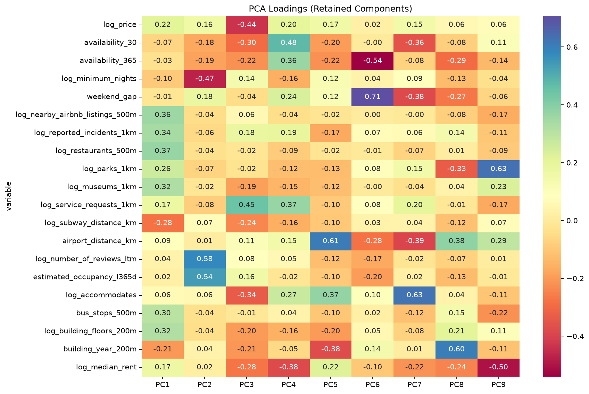

# Project 2: Data Integration, Research Question Refinement, and PCA

**Team Members:** Seohyun Hong, Seoyoung Yun, Sieun Woo

**Notebook:** [CDS303_Final_Project2_Portable.ipynb](Projects/Project2/CDS303_Final_Project2_Portable.ipynb)

---

## 1. Data Integration and Preparation

### 1.1 Datasets
| Dataset | Provider | Original unit (one row =) | Size used |
|---|---|---|---|
| **Primary:** NYC detailed listings (Sep 14, 2026) | Inside Airbnb | one listing | 29,918 listings |
| NYC calendar (Sep 14, 2026 – Sep 14, 2027) | Inside Airbnb | one listing on one date | 10.9 million rows |
| CommonPlace (points of interest) | NYC Open Data | one place | 1,274 parks, 95 museums |
| MTA Subway Stations and Complexes | NY State Open Data | one station | 445 station complexes |
| Airports (JFK, LGA, EWR) | OurAirports | one airport | 3 airports |
| DOHMH Restaurant Inspection Results | NYC Open Data | one inspection | 295,040 rows → 30,704 restaurants |
| NYPD Complaint Data (Year To Date) | NYC Open Data | one reported incident | 372,940 incidents (Jan–Aug 2026) |
| 311 Service Requests – **Noise - Residential** only | NYC Open Data | one complaint | 249,908 complaints (Jan–Aug 2026) |

### 1.2 What each row represents and how the datasets connect
- **One row in the combined dataset = one Airbnb listing.**
- **Calendar → listing ID.** The calendar has about 365 rows per listing, so a direct merge would repeat each listing 365 times. We first **aggregated** it to one row per listing (weekday and weekend availability rates) and then merged on `id` = `listing_id`.
- **All other sources → location.** They have no Airbnb ID, so we used each listing's latitude and longitude and **transformed** each source into per-listing numbers:

| New variable | Definition |
|---|---|
| `parks_1km`, `museums_1km` | Number of parks / museums within 1 km |
| `subway_distance_km` | Distance to the nearest subway station complex |
| `airport_distance_km` | Distance to the nearest of JFK, LGA, EWR |
| `restaurants_500m` | Number of unique restaurants (one per `CAMIS`) within 500 m |
| `reported_incidents_1km` | NYPD reported incidents within 1 km (Jan–Aug 2026) |
| `service_requests_1km` | 311 **residential noise complaints** within 1 km (Jan–Aug 2026) |
| `nearby_airbnb_listings_500m` | Other Airbnb listings within 500 m |

### 1.3 Merge checks
| Check | Result |
|---|---|
| Rows before / after integration | 29,918 / 29,918 |
| Duplicate listing IDs | 0 |
| Listings without calendar data | 0 |
| Duplicates removed before counting | Restaurants by `CAMIS`, NYPD by `CMPLNT_NUM`, 311 by `Unique Key`, subway by `Complex ID` |
| Time window | NYPD and 311 restricted to the same period (Jan–Aug 2026), before the Sep 2026 Airbnb snapshot |

Every source was converted to listing-level values before merging, so no observations were duplicated and no incompatible geographic or time units were combined.

### 1.4 Missing values
- `price` is missing for **10,512 listings (35.1%)**. Almost all listings with 0 available days in the next year (7,009 of 7,018) have no price, so the missing prices mostly belong to listings that are not open for booking. Filling them in would invent prices, so we **removed** them. The PCA uses **19,406 priced listings**, which describe *actively offered listings*.
- `minimum_nights` was missing for 7 priced listings and was filled with the median.

### 1.5 Variable selection
**PCA input variables (12, all numerical):**

| Variable | Meaning | Transformation |
|---|---|---|
| `log_price` | Nightly price | Capped at 99th percentile, log1p |
| `availability_30`, `availability_365` | Open days in the next 30 / 365 days | — |
| `log_minimum_nights` | Minimum stay | Capped at 99th percentile, log1p |
| `log_nearby_airbnb_listings_500m` | Nearby Airbnb supply | log1p |
| `log_restaurants_500m`, `log_parks_1km`, `log_museums_1km` | Nearby amenities | log1p |
| `subway_distance_km`, `airport_distance_km` | Access | — |
| `log_reported_incidents_1km` | NYPD reported incidents nearby | log1p |
| `log_service_requests_1km` | Residential noise complaints nearby | log1p |

**Excluded from PCA:**
- `id`, `listing_id`, `host_id`: identifiers, not measurements.
- `Latitude`, `Longitude`: used only for matching locations.
- `room_type`, borough, `license`, `calculated_host_listings_count`: kept to **explain** the groups in the later classification step. Encoded categorical variables were not used in PCA because one-hot (0/1) columns are not continuous measurements and, after standardization, rare categories can dominate a component.
- `weekday_availability_rate`, `weekend_availability_rate`: repeat the information in the availability variables.

### 1.6 Standardization
The variables are measured in different units (dollars, days, kilometers, counts). PCA looks for directions of largest variance, so without scaling, variables with large numbers (such as `availability_365`, 0–365) would dominate. Following Demo 6, we used `StandardScaler` so every variable has mean 0 and standard deviation 1. Skewed price and count variables were log-transformed first.

---

## 2. Refined Research Question and Audience

**Research question.**
> What are the main dimensions of variation among actively offered NYC Airbnb listings when price, availability, minimum-night requirements, nearby amenities, subway and airport access, nearby competing listings, reported incidents, and residential noise complaints are considered together, and how can these dimensions help hosts compare their listings?

**Audience.** Current and prospective **NYC Airbnb hosts and small short-term-rental property managers** who run one or a few listings.

**Relevance.** A host usually sets price, minimum stay, and open dates by looking only at a few similar-looking listings. Price alone does not show whether a listing is in a busy central area or a quiet outer area, how easy it is to reach, or whether nearby competitors are mostly short stays or monthly rentals. Hosts need to know which listing and neighborhood characteristics vary together.

**Potential use.** The PCA shows which characteristics vary together, and the next step (clustering) will group listings with similar profiles. A host can then compare their price, minimum-night rule, and availability with listings in the **same profile** instead of the whole city, for example when deciding whether to offer short stays or 30+ night stays.

---

## 3. PCA Results

### 3.1 Component selection
| Component | Eigenvalue | Explained variance | Cumulative |
|---|---|---|---|
| PC1 | 4.40 | 36.7% | 36.7% |
| PC2 | 1.65 | 13.7% | 50.4% |
| PC3 | 1.34 | 11.2% | 61.5% |
| PC4 | 1.08 | 9.0% | 70.5% |
| PC5 | 0.91 | 7.6% | 78.1% |
| PC6 | 0.64 | 5.4% | 83.5% |
| PC7 | 0.59 | 4.9% | 88.4% |
| PC8 | 0.47 | 3.9% | 92.3% |
| PC9 | 0.37 | 3.1% | 95.4% |
| PC10 | 0.27 | 2.2% | 97.6% |
| PC11 | 0.17 | 1.4% | 99.0% |
| PC12 | 0.12 | 1.0% | 100.0% |

We retain **6 components**, the smallest number that explains **at least 80%** of the variance (83.5%). For comparison, the eigenvalue > 1 rule would keep 4 components (70.5%). The scree plot drops sharply after PC1 and flattens after about PC6, so 6 components keep most of the information while reducing 12 variables to half.

### 3.2 Component interpretation

| Component | Strongest variables (loading) | What it appears to represent |
|---|---|---|
| **PC1 (36.7%)** | restaurants (0.42), nearby Airbnb listings (0.42), NYPD reports (0.41), museums (0.37), parks (0.30), subway distance (−0.32) | **Busy, central neighborhood vs. quiet outer area** |
| **PC2 (13.7%)** | price (0.54), noise complaints (−0.47), minimum nights (−0.42) | **Higher-priced short stays vs. monthly rentals in noisier residential areas** |
| **PC3 (11.2%)** | availability 365 (0.67), availability 30 (0.60), minimum nights (0.36) | **How open the calendar is** |
| PC4 (9.0%) | airport distance (0.74), parks (−0.36) | Distance from airports |
| PC5 (7.6%) | airport distance (0.56), minimum nights (0.52), noise complaints (−0.47) | Mixed: far, longer-stay listings in quieter areas |
| PC6 (5.4%) | availability 365 (0.67), availability 30 (−0.64) | Long-term vs. near-term availability |

### 3.3 Biplot and discussion

- The neighborhood-activity arrows (restaurants, nearby Airbnb listings, NYPD reports, parks, museums) point to the right, and subway distance points to the left, so PC1 is one "urban activity" direction.
- Price points up and to the right, while minimum nights and residential noise complaints point down.
- The points form one continuous cloud: denser on the right (central neighborhoods) and more spread out on the left (outer areas far from the subway).
- **PCA identifies directions of variation, not clusters.** Dense or sparse areas in the plot are not confirmed groups. The biplot shows only PC1 and PC2; all 6 retained components will be used for clustering.

**Relation to the research question and audience.** NYC listings differ mainly in (1) how busy and central the surrounding neighborhood is, (2) whether the listing is a higher-priced short stay or a lower-priced monthly rental, and (3) how open its calendar is. For hosts, this means a fair comparison should consider neighborhood setting and stay type together with price. In the next session, the retained components will be used to group listings, and room type, borough, host listing count, and license status will help explain the groups.

### 3.4 Limitations
- 35.1% of listings without a price were excluded, so results describe actively offered listings only.
- Unavailable calendar dates may be booked **or** blocked by the host.
- 311 data include only residential noise complaints, and NYPD reports are reported incidents, not an objective safety score.
- CommonPlace and restaurant data are November 2026 snapshots, slightly later than the September 2026 Airbnb data.
- Airbnb coordinates are slightly shifted for privacy, so nearby counts are approximate.
- No clustering or classification was performed in this session.

---

