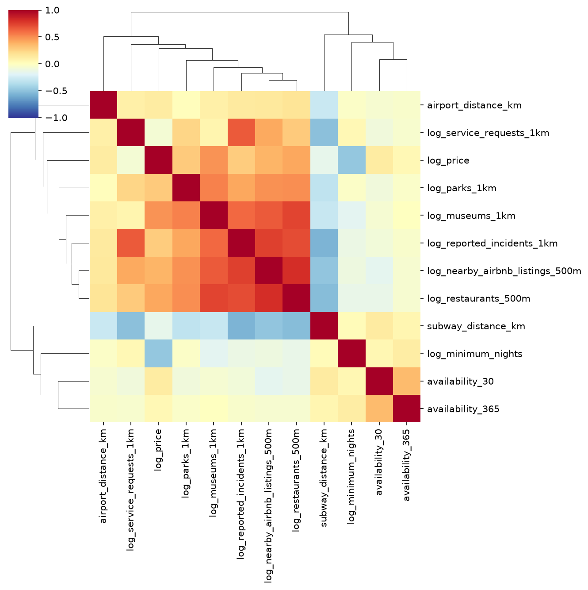
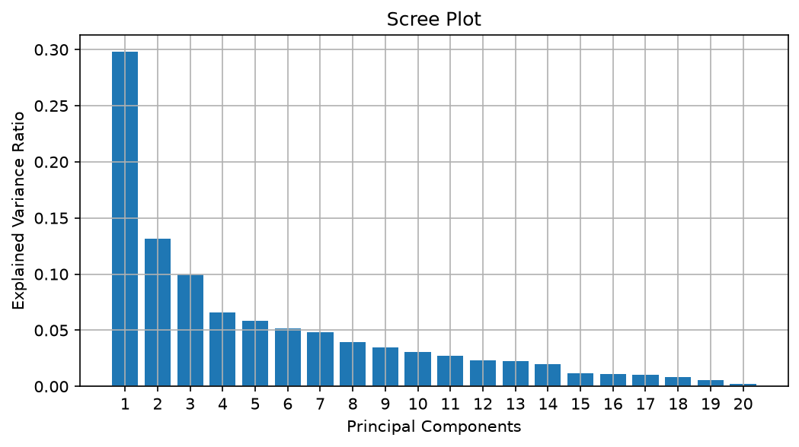
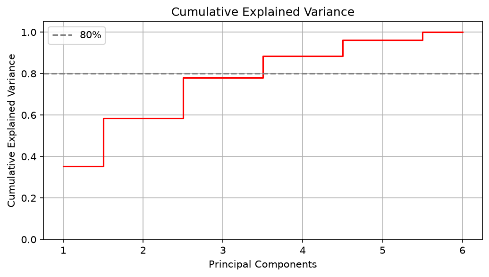

# Project 2: Data Integration, Research Question Refinement, and PCA

**Notebook:** [CDS303_Final_Project2_Final_Demo06.ipynb](Projects/Project2/CDS303_Final_Project2_Final_Demo06.ipynb)

**Team member: Seohyun Hong, Sieun Woo, Seoyoung Yun**
---

## 1. Data Integration and Preparation

### 1.1 Datasets
| Dataset | Provider | Original unit (one row =) | Time | Role |
|---|---|---|---|---|
| **Primary:** NYC detailed listings | Inside Airbnb | one listing | Sep 14, 2026 snapshot | PCA input |
| NYC calendar | Inside Airbnb | one listing on one date | Sep 14, 2026 – Sep 14, 2027 | Comparison |
| NYPD Complaint Data (Year To Date) | NYC Open Data | one reported incident | Jan–Aug 2026 | **PCA input** |
| 311 Service Requests – Noise - Residential only | NYC Open Data | one complaint | Jan–Aug 2026 | Comparison |
| DOHMH Restaurant Inspection Results | NYC Open Data | one inspection | Inspections on or before Sep 14, 2026 | Comparison |
| CommonPlace (parks, museums) | NYC Open Data | one place | Nov 2026 download | Comparison |
| MTA Subway Stations and Complexes | NY State Open Data | one station | Nov 2026 download | Comparison |
| Airports (JFK, LGA, EWR) | OurAirports | one airport | — | Comparison |

Large raw files are not stored in this repository because of GitHub's file size limit; see [large_files_not_uploaded.md](Projects/data/large_files_not_uploaded.md).

### 1.2 What each row represents and how the datasets connect
- **One row in the combined dataset = one Airbnb listing.**
- **Calendar → listing ID.** The calendar has about 365 rows per listing. We first **aggregated** it to one row per listing (weekday and weekend availability rates) and then merged on `id` = `listing_id`.
- **Other sources → location.** They have no Airbnb ID, so we used each listing's latitude and longitude and **transformed** each source into per-listing values:

| New variable | Definition |
|---|---|
| `reported_incidents_1km` | NYPD reported incidents within 1 km (Jan–Aug 2026) |
| `service_requests_1km` | 311 **residential noise complaints** within 1 km (Jan–Aug 2026) |
| `restaurants_500m` | Restaurants (one per `CAMIS`, inspected on or before Sep 14, 2026) within 500 m |
| `parks_1km`, `museums_1km` | Parks / museums within 1 km |
| `subway_distance_km` | Distance to the nearest subway station complex |
| `airport_distance_km` | Distance to the nearest of JFK, LGA, EWR |
| `nearby_airbnb_listings_500m` | Other Airbnb listings within 500 m (from the primary dataset) |

### 1.3 Merge checks
| Check | Result |
|---|---|
| Rows before / after integration | 29,918 / 29,918 |
| Duplicate listing IDs | 0 |
| Listings without calendar data | 0 |
| Duplicates removed before counting | Restaurants by `CAMIS`, NYPD by `CMPLNT_NUM`, 311 by `Unique Key`, subway by `Complex ID` |

### 1.4 Matching time periods
The Airbnb listings are a **September 14, 2026** snapshot, but some supplementary files were downloaded in November 2026. To avoid combining incompatible time periods:
- **PCA uses only variables from the September snapshot or from the period before it**: the listing variables, nearby Airbnb supply, and NYPD incidents from January–August 2026.
- Restaurant records were limited to inspections **on or before September 14, 2026** (30,161 restaurants).
- 311 complaints were limited to January–August 2026, the same window as NYPD.
- Variables from later snapshots (parks, museums, subway, airports) and the remaining supplementary variables are used **only for comparison** with the PCA results, not as PCA inputs.

### 1.5 Missing values
- `price` is missing for **10,512 listings (35.1%)**. Almost all listings with 0 available days in the next year (7,009 of 7,018) have no price, and the median availability of listings without a price is 0 days. We **removed** listings without a positive price, so the PCA uses **19,406 listings** that are actively offered.
- `minimum_nights` was missing for 7 of these listings and was filled with the median.

### 1.6 Variable selection
**PCA input variables (6, all numerical):**

| Variable | Meaning | Transformation |
|---|---|---|
| `log_price` | Nightly price | Capped at 99th percentile, log1p |
| `availability_30` | Open days in the next 30 days | — |
| `availability_365` | Open days in the next 365 days | — |
| `log_minimum_nights` | Minimum stay | Capped at 99th percentile, log1p |
| `log_nearby_airbnb_listings_500m` | Other Airbnb listings within 500 m | log1p |
| `log_reported_incidents_1km` | NYPD reported incidents within 1 km | log1p |

**Excluded from PCA:**
- `id`, `listing_id`, `host_id`: identifiers, not measurements.
- `Latitude`, `Longitude`: used only for matching locations.
- `room_type`, borough, `license`, `calculated_host_listings_count`: categorical or kept to explain groups in the later classification step. Encoded categorical variables were not used because one-hot (0/1) columns are not continuous measurements and rare categories can dominate a component after standardization.
- Parks, museums, subway, airports, restaurants, 311 noise complaints, and calendar weekday/weekend rates: used for comparison only (see 1.4).

### 1.7 Standardization
The six variables are measured in different units (log dollars, days, counts). PCA finds directions of largest variance, so without scaling, `availability_365` (0–365 days) would dominate. Following Demo 6, we used `StandardScaler` so every variable has mean 0 and standard deviation 1. Skewed price and count variables were log-transformed first.

---

## 2. Refined Research Question and Audience

**Research question.**
> What are the main patterns of variation among actively offered NYC Airbnb listings based on price, availability, minimum-night requirements, nearby Airbnb supply, and reported neighborhood incidents, and how are these patterns related to other neighborhood conditions such as restaurants, museums, and subway access?

**Audience.** Current and prospective **NYC Airbnb hosts and small property managers** who operate one or a few listings.

**Relevance.** Hosts usually set price, minimum stay, and open dates by looking at a few similar-looking listings. Price alone does not show whether a listing is in a busy area with many competing listings, how open its calendar is compared with others, or whether it follows a short-stay or monthly-rental pattern.

**Potential use.** The PCA shows which listing characteristics vary together, and the next step (clustering) will group listings with similar profiles. A host can then compare their price, minimum-night rule, and availability with listings in the **same profile**, for example when deciding whether to offer short stays or 30+ night stays. These results describe patterns; they do not predict bookings, revenue, or profit.

---

## 3. PCA Results

### 3.1 Component selection
| Component | Eigenvalue | Explained variance | Cumulative |
|---|---|---|---|
| PC1 | 2.12 | 35.3% | 35.3% |
| PC2 | 1.40 | 23.3% | 58.6% |
| PC3 | 1.16 | 19.4% | 77.9% |
| PC4 | 0.64 | 10.6% | 88.5% |
| PC5 | 0.46 | 7.7% | 96.2% |
| PC6 | 0.23 | 3.8% | 100.0% |

We retain **4 components**, the smallest number that explains **at least 80%** of the variance (88.5%). The eigenvalue > 1 rule would keep 3 components (77.9%), just below 80%. We keep PC4 because it adds 10.6% of the variance and has a clear meaning (short-term vs. annual availability).

### 3.2 Component interpretation
| Variable | PC1 | PC2 | PC3 | PC4 |
|---|---|---|---|---|
| `log_price` | **0.46** | 0.37 | −0.34 | −0.02 |
| `availability_30` | −0.13 | **0.68** | 0.10 | **−0.68** |
| `availability_365` | −0.11 | **0.61** | 0.34 | **0.70** |
| `log_minimum_nights` | −0.34 | −0.16 | **0.69** | −0.19 |
| `log_nearby_airbnb_listings_500m` | **0.58** | −0.07 | 0.37 | −0.01 |
| `log_reported_incidents_1km` | **0.56** | −0.04 | 0.40 | −0.11 |

- **PC1 (35.3%) – Price and local activity.** High: many nearby Airbnb listings (0.58), more reported incidents (0.56), and higher price (0.46); low: longer minimum stays (−0.34). Listings in busy areas with many competitors tend to be more expensive and allow shorter stays.
- **PC2 (23.3%) – Listing availability.** High: open days in the next 30 days (0.68) and 365 days (0.61), together with higher price (0.37).
- **PC3 (19.4%) – Minimum stay requirements.** Mainly longer minimum stays (0.69), with lower price (−0.34).
- **PC4 (10.6%) – Short-term vs. annual availability.** `availability_365` (0.70) and `availability_30` (−0.68) move in opposite directions: listings open for much of the year but not in the next month, versus listings open now but not for the whole year.

**Comparison with variables not used in PCA** (correlation with PC scores):

| Variable | PC1 | PC2 |
|---|---|---|
| Restaurants within 500 m | 0.71 | 0.05 |
| Museums within 1 km | 0.63 | 0.09 |
| Parks within 1 km | 0.31 | −0.01 |
| 311 noise complaints within 1 km | 0.24 | −0.12 |
| Airport distance | 0.16 | −0.03 |
| Subway distance | −0.48 | 0.10 |
| Calendar weekday availability rate | −0.16 | 0.73 |
| Calendar weekend availability rate | −0.16 | 0.72 |

Listings with high PC1 scores have more restaurants and museums nearby and are closer to the subway, which supports reading PC1 as a **busy, central-neighborhood** dimension. The calendar availability rates are strongly related to PC2, which supports reading PC2 as **availability**.

### 3.3 Biplot and discussion

- Nearby Airbnb listings and NYPD reports point to the right (PC1); the two availability arrows point up (PC2); price points up and to the right; minimum nights points to the left and slightly down.
- **[그림 확인 후 수정]** The points form one continuous cloud without clearly separated groups.
- **PCA identifies directions of variation, not clusters.** Dense or sparse areas in the plot are not confirmed groups. The biplot shows only PC1 and PC2 (58.6% of the variance); all 4 retained components will be used for clustering.

**Relation to the research question and audience.** NYC listings differ mainly in (1) price together with how busy and competitive the surrounding area is, (2) how open the calendar is, and (3) how long guests must stay. For hosts, this means a fair comparison should consider location activity, availability, and minimum-stay rules together with price. In the next session, the retained components will be used to group listings, and room type, borough, host listing count, and license status will help explain the groups.

### 3.4 Limitations
- 35.1% of listings without a price were excluded, so results describe actively offered listings only.
- Unavailable calendar dates may be booked **or** blocked by the host.
- The 311 data include only residential noise complaints, and a complaint is a report rather than a measured noise level. NYPD counts are reported incidents, not direct safety scores.
- Parks, museums, and subway data were downloaded in November 2026, so they may not show exact September conditions; they were used only for comparison.
- Airbnb coordinates are slightly shifted for privacy, so nearby counts are approximate.
- No clustering or classification was performed in this session.

---

## Supporting Files
- [Notebook](Projects/Project2/CDS303_Final_Project2_Final_Demo06.ipynb)
- [Combined dataset](Projects/Project2/data/airbnb_integrated_part1.csv)
- [PCA input](Projects/Project2/data/airbnb_pca_input.csv) · [Explained variance](Projects/Project2/data/pca_explained_variance.csv) · [Loadings](Projects/Project2/data/pca_loadings.csv) · [PCA scores](Projects/Project2/data/pca_scores.csv)
